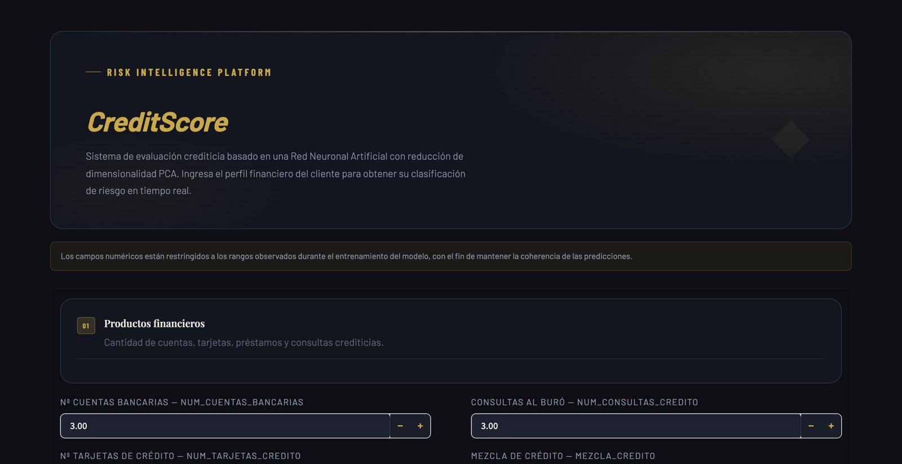
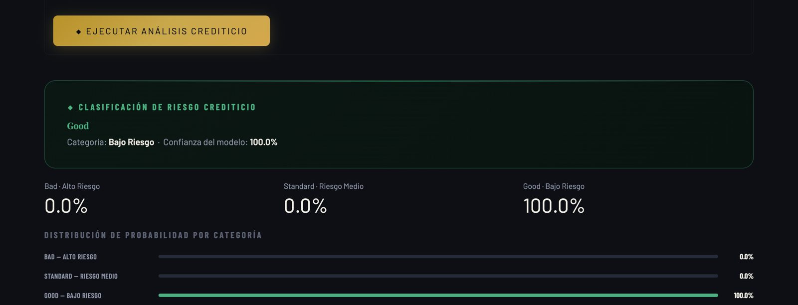
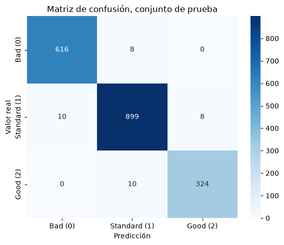

# CreditScore: clasificación de riesgo crediticio con una red neuronal

Aplicación web que recibe el perfil financiero de un cliente (cuentas, tarjetas, deuda, retrasos en pagos, utilización del crédito, entre otros) y lo clasifica en riesgo alto, medio o bajo, con la probabilidad de cada categoría.

**Demo en vivo:** https://credit-score-app-v2-twqrfn7cwczj2wy7brujyf.streamlit.app/ (si la app está dormida, Streamlit pide un clic para despertarla y tarda cerca de un minuto).





**English summary:** Streamlit app that classifies a client's credit score as Bad, Standard or Good. The pipeline uses ANOVA feature selection, Min-Max scaling, PCA (8 components) and a small Keras neural network, reaching 98% accuracy on a held-out test set. A comparison with simple baselines shows that a logistic regression and a depth-5 decision tree perform just as well, which says more about the dataset than about the network; the notebook documents this.

## Cómo funciona

1. **Limpieza:** se quitan identificadores (ID, nombre, documento) y columnas de texto libre.
2. **Codificación:** las variables categóricas (mezcla de crédito, pago del monto mínimo, comportamiento de pago) pasan a números con `LabelEncoder`.
3. **División:** 85% entrenamiento y 15% prueba, estratificada por clase. Todo lo que sigue se ajusta solo con entrenamiento.
4. **Selección de variables:** `SelectKBest` con prueba F de ANOVA escoge 15 de las 20 variables.
5. **Escalado y PCA:** `MinMaxScaler` y PCA con 8 componentes, que conservan el 87% de la varianza.
6. **Red neuronal:** capas densas de 64, 32 y 16 neuronas con salida softmax de 3 clases, entrenada con early stopping.
7. **App:** Streamlit carga el modelo y las tres transformaciones guardadas, y aplica el mismo pipeline a los datos que escribe el usuario. Los campos solo aceptan valores dentro del rango visto en entrenamiento.

## Resultados

Evaluación en 1.875 clientes de prueba que el modelo no vio durante el entrenamiento:

- Exactitud: 98,1%
- Bad (riesgo alto): precisión 0,98, recall 0,99
- Standard (riesgo medio): precisión 0,98, recall 0,98
- Good (riesgo bajo): precisión 0,98, recall 0,97



## Lo más importante que aprendí

Una exactitud del 98% en riesgo crediticio es sospechosa, así que comparé la red con modelos simples entrenados con los mismos datos:

- Regresión logística: 98,7%
- Árbol de decisión de profundidad 5: 98,6%
- Red neuronal con PCA: 98,1%
- Árbol de decisión de profundidad 2: 97,2%

Un árbol que solo mira la utilización del crédito y la cuota mensual ya acierta el 97% de las veces, y sus reglas no tienen sentido financiero (marca como riesgo alto a quien usa poco su crédito). La conclusión es que la etiqueta de este dataset académico se explica casi por completo con dos umbrales; la red funciona, pero un modelo simple e interpretable sería la mejor elección. Con datos reales de un banco no se debe esperar este desempeño.

También corregí la primera versión del cuaderno: ajustaba el escalado, la selección de variables y el PCA con todos los datos antes de separar la prueba, y sus celdas no corrían en orden. La versión actual corre de principio a fin y evita esa fuga de información.

## Tecnologías

Python, pandas, scikit-learn, TensorFlow/Keras, Streamlit, joblib.

## Cómo ejecutarlo en local

```bash
git clone https://github.com/leydymf/credit-score-app-v2.git
cd credit-score-app-v2
python3 -m venv .venv
source .venv/bin/activate
pip install -r requirements.txt
streamlit run app.py
```

Para volver a entrenar el modelo, abre [`notebooks/riesgo_crediticio.ipynb`](notebooks/riesgo_crediticio.ipynb) (corre en local o en Google Colab). El cuaderno descarga el dataset por sí mismo y al final reemplaza los cuatro archivos que usa la app:

- `modelo_riesgo_credito.keras`: la red neuronal
- `minmax_scaler.joblib`: el escalado
- `pca_8_componentes.joblib`: el PCA
- `label_encoders.joblib`: la codificación de variables categóricas

Para el cuaderno hacen falta además `openpyxl`, `matplotlib` y `seaborn`.

## Datos

El dataset `riesgo.xlsx` (12.500 clientes) lo publica el profesor del curso en [github.com/adiacla/bigdata](https://github.com/adiacla/bigdata). Es una versión del dataset público de clasificación de puntaje crediticio de Kaggle. El repositorio no incluye los datos; el cuaderno los descarga.

## Autoría

Leydy Macareo, Ingeniería de Sistemas, UNAB, 2026.
